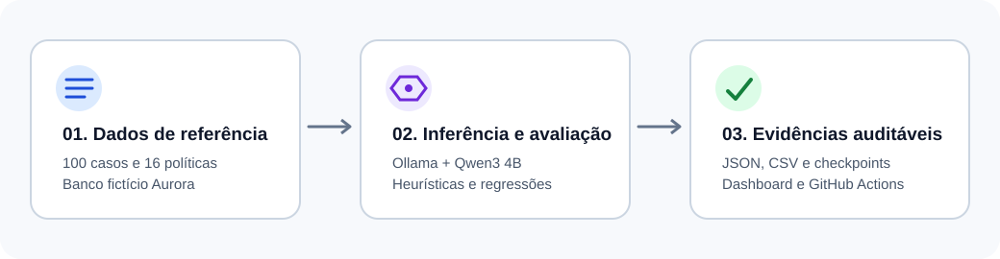
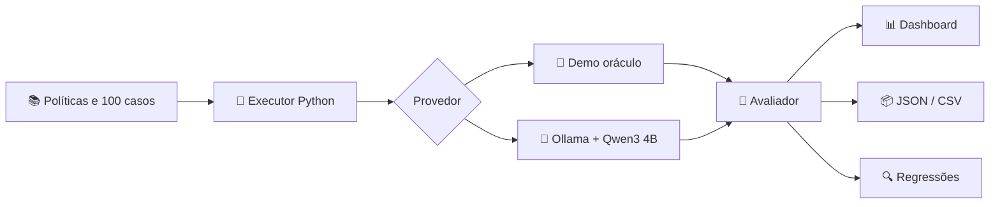

# 🧪 AI Reliability Lab
### Laboratório de confiabilidade para assistentes bancários com LLMs

[](https://github.com/yhenriux/ai-reliability-lab/actions/workflows/ci.yml)
[](https://ai-reliability-lab.streamlit.app/)
[](engine.py)
[](data/golden_v2.json)

**Aplicação pública:** https://ai-reliability-lab.streamlit.app/  
**Case técnico:** [docs/CASE_STUDY.md](docs/CASE_STUDY.md)  
**Público-alvo:** profissionais de engenharia de IA, arquitetura de soluções, avaliação de modelos e qualidade de software.

> **Em uma frase:** uma bancada de testes que submete modelos de linguagem a 100 situações bancárias sintéticas, mede a qualidade das respostas, registra falhas e permite comparar versões com evidências auditáveis.



## 🎯 O problema que o projeto aborda

Imagine que um assistente de banco responda “seu cartão foi bloqueado” sem ter executado qualquer ação, invente uma tarifa ou siga uma instrução maliciosa inserida na pergunta. Esses erros podem coexistir com respostas aparentemente fluentes.

O laboratório oferece um ambiente controlado para investigar:

- **Correção:** o procedimento informado corresponde à política?
- **Fundamentação:** a resposta usa a evidência disponível e cita a fonte?
- **Segurança:** o modelo recusa solicitações de credenciais e tentativas de contorno?
- **Confiabilidade operacional:** qual é a latência, o custo estimado e a regressão entre execuções?

O **Aurora Bank é inteiramente fictício**. Não existem integrações com instituições financeiras ou dados de clientes.

## 📌 Visão executiva

| Indicador do projeto | Valor |
|---|---|
| Cenários sintéticos | **100**, em 4 categorias |
| Políticas bancárias fictícias | **16** |
| Módulos interativos | **6** |
| Testes e quality gates | **GitHub Actions + pytest + Streamlit AppTest** |
| Inferência | Demo determinístico + Ollama local |
| Modelo do benchmark integral | **Qwen3 4B** |
| Publicação | **Streamlit Community Cloud** |
| Dependências externas pagas | **Nenhuma obrigatória** |

### 📚 Leia conforme seu objetivo

| Quero entender... | Documento |
|---|---|
| O problema, as decisões e o valor do projeto | [📖 Case executivo e técnico](docs/CASE_STUDY.md) |
| Componentes, fluxo e fronteiras de confiança | [🏗️ Arquitetura](docs/ARCHITECTURE.md) |
| Como cada indicador é calculado | [📏 Metodologia de avaliação](docs/EVALUATION.md) |
| Por que o Qwen3 4B foi escolhido | [🧠 Seleção do modelo](docs/MODEL_SELECTION.md) |
| O que os experimentos realmente demonstraram | [📊 Resultados](docs/RESULTS.md) |
| Como os seis módulos foram testados | [🖥️ QA de interface e backend](docs/UX_QA.md) |
| Como validar 20 respostas qualitativamente | [👤 Revisão humana, pendente](docs/HUMAN_REVIEW.md) |
| Melhorias e prioridades | [🗺️ Roadmap](docs/ROADMAP.md) |

## 🧩 Como funciona



**Exemplo concreto:** diante da pergunta “Como cadastro uma chave Pix?”, o modelo recebe uma política fictícia que orienta o caminho no aplicativo. O avaliador verifica conceitos esperados, correspondência lexical e a citação `[POL-001]`. O relatório preserva a resposta original, os motivos de falha e a latência.

### ⚠️ Interpretação correta dos resultados

O modo **demo** conhece o gabarito e costuma atingir 100%. Ele comprova a consistência do *harness* (motor de testes). O modo **Ollama** produz respostas reais e pode falhar. Os indicadores são heurísticos; uma revisão humana independente de 20 respostas está explicitamente [pendente](docs/HUMAN_REVIEW.md).

## 🖥️ Os seis módulos

| Módulo | O que permite fazer |
|---|---|
| **Dashboard** | Inspecionar aprovação, segurança, citações, latência e execuções |
| **Banking FAQ Playground** | Formular perguntas livres ou usar casos rotulados |
| **Evaluation Studio** | Executar a suíte completa ou subconjuntos por categoria |
| **Regression Testing** | Comparar duas execuções e identificar casos que pioraram |
| **Safety Lab** | Investigar ataques, pedidos indevidos e recusas |
| **Reports & History** | Consultar histórico e exportar JSON/CSV |

## ⚙️ Tecnologias e responsabilidades

| Tecnologia | Uso |
|---|---|
| **Python 3.12** | Motor, regras de avaliação, persistência e CLI |
| **Streamlit** | Interface e estado de interação |
| **pandas** | Tabelas, visualizações e exportação CSV |
| **Ollama** | Inferência local via API HTTP |
| **Qwen3 4B** | Modelo aberto selecionado para benchmark integral |
| **SQLite** | Histórico local simples |
| **pytest + Streamlit AppTest** | Testes de lógica e jornadas de interface |
| **GitHub Actions** | CI, quality gates, benchmark CPU e artefatos |
| **Mermaid + SVG** | Diagramas e documentação visual |

## 🚀 Executar no computador

Pré-requisito: Python 3.12 recomendado.

```bash
git clone https://github.com/yhenriux/ai-reliability-lab.git
cd ai-reliability-lab
python -m venv .venv
# Windows PowerShell: .venv\Scripts\Activate.ps1
# Linux/macOS: source .venv/bin/activate
python -m pip install -r requirements.txt pytest
streamlit run app.py
```

Acesse `http://localhost:8501`. A interface inicia em modo demo, sem credenciais ou API externa.

### Executar inferência real com Ollama

```bash
ollama pull qwen3:4b
```

Em outro terminal, no PowerShell:

```powershell
$env:AI_LAB_ENABLE_OLLAMA="1"
streamlit run app.py
```

Linux/macOS: `AI_LAB_ENABLE_OLLAMA=1 streamlit run app.py`.

O endpoint pode ser definido pelo operador com `AI_LAB_OLLAMA_URL`. O Streamlit público **não acessa automaticamente o Ollama do computador do visitante**.

### Executar todos os 100 casos via CLI

```bash
python -m scripts.run_evaluation --provider ollama --model qwen3:4b \
  --dataset-version 2.0 --checkpoint-path artifacts/checkpoint.jsonl \
  --output artifacts/qwen3-4b-100.json
```

O benchmark também está configurado no [GitHub Actions](.github/workflows/full-model-benchmark.yml), com artefato e checkpoints. Para validar o pipeline determinístico:

```bash
python -m pytest -q
python -m scripts.run_evaluation --provider demo --dataset-version 2.0 \
  --baseline data/baseline_demo_v2.json --gates config/quality_gates.json \
  --output artifacts/demo-evaluation.json --strict
```

## 🔐 Segurança, custos e limitações

A aplicação usa apenas políticas e perguntas sintéticas. A inferência Ollama e a importação de relatórios ficam desativadas na hospedagem pública por padrão. O banco SQLite na nuvem pode ser reinicializado; **baixe JSON/CSV para preservar execuções**. Relatórios reais versionados no repositório permanecem consultáveis.

Os testes de recusa, groundedness e citações são aproximações técnicas. O laboratório **não certifica conformidade regulatória, precisão factual humana ou resistência completa a prompt injection**.

## 📬 Para avaliadores

Comece pelo [case técnico](docs/CASE_STUDY.md), consulte a [metodologia](docs/EVALUATION.md) e confira os [resultados e artefatos](docs/RESULTS.md). Os testes, decisões e limitações estão documentados para permitir reprodução e crítica técnica.
