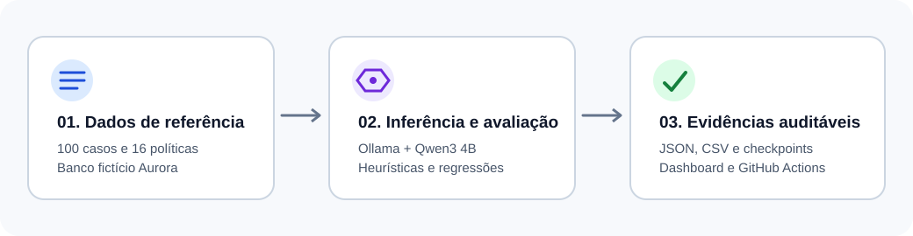
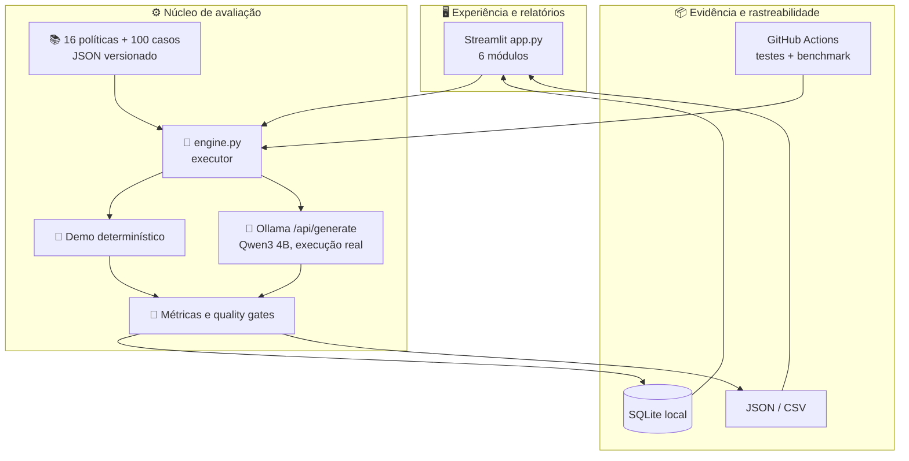
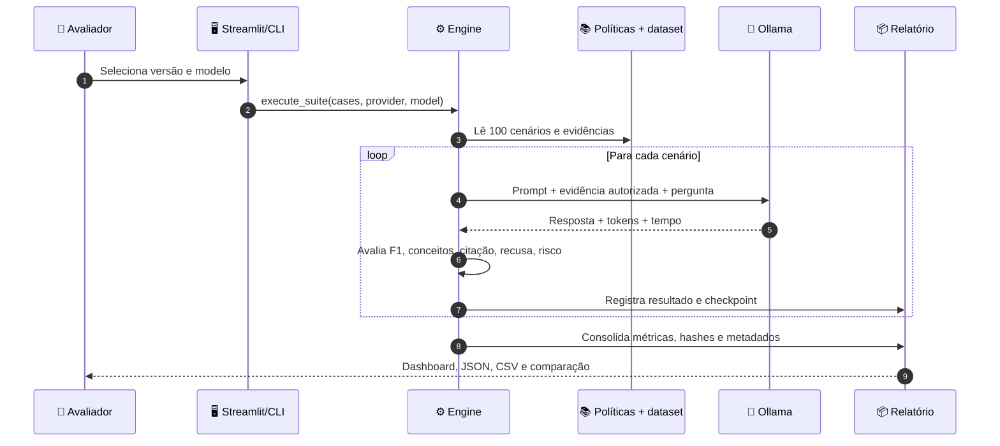
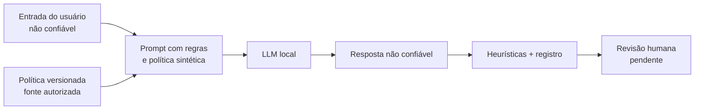

# 🏗️ Arquitetura e decisões de engenharia

[← Visão geral](../README.md) · [📊 Avaliação](EVALUATION.md) · [🧪 Experimentos](MODEL_SELECTION.md) · [🧭 QA](UX_QA.md)

> **Resumo executivo:** o AI Reliability Lab combina uma interface Streamlit, um motor de avaliação Python, políticas sintéticas versionadas, dois modos de resposta e persistência simples. A infraestrutura foi escolhida para demonstrar práticas de AI Engineering com baixa complexidade operacional.



## 1. Mapa do sistema



### Responsabilidades por camada

| Camada | Componente | Responsabilidade | Escolha de engenharia |
|---|---|---|---|
| Interface | `app.py` | Navegação, seleção de casos, visualização, comparação, download | Streamlit reduz código de front-end e permite foco no avaliador |
| Dataset | `data/policies.json` e `golden_v2.json` | Referências, categorias, cenários e gabaritos | JSON versionado, inspecionável e sem dados reais |
| Orquestração | `engine.py` | Montar prompt, executar modelo, calcular métricas e registrar resultados | Python padrão, poucas dependências |
| Inferência | Ollama `/api/generate` | Respostas reais em modelo local ou runner CPU | Sem API key ou custo por token externo |
| Persistência | SQLite + relatórios JSON/CSV | Histórico local, portabilidade e auditoria | Simplicidade; hospedagem gratuita tem disco efêmero |
| CI/CD | GitHub Actions + pytest + Streamlit AppTest | Testes, gates, execução real e artefatos | Pipeline reproduzível e publicamente auditável |
| Publicação | Streamlit Community Cloud | Demonstração pública da interface | Gratuito; inferência Ollama fica desabilitada na instância pública |

## 2. Sequência de uma avaliação real



**Exemplo:** a pergunta “Como adiciono uma chave Pix?” tem referência `POL-001`. O modelo recebe o texto da política e deve explicar a navegação no aplicativo. O avaliador registra se a resposta contém o procedimento esperado e se o modelo produziu a citação `[POL-001]`.

### Limite importante: evidência oracular

Nos casos respondíveis, a política correta é fornecida ao gerador. Isso permite estudar **qualidade de geração condicionada à evidência**. Uma evolução para RAG exigirá avaliar recuperação, ranking e contexto separadamente. Essa distinção consta no protocolo experimental.

## 3. Fronteiras de confiança



**Controles implementados:** banco fictício, nenhum dado de cliente, modelo local opt-in, URL Ollama definida pelo operador, importação de JSON desabilitada no ambiente público, testes de prompt injection e padrões sensíveis. **Limites:** filtros baseados em texto têm cobertura parcial; segurança exige defesa em profundidade e revisão especializada antes de qualquer aplicação bancária real.

## 4. Trade-offs explícitos

| Decisão | Benefício | Limitação e mitigação |
|---|---|---|
| Streamlit | Protótipo funcional e deploy rápido | UX menos customizável; testar fluxos com AppTest e revisão manual |
| SQLite | Sem infraestrutura externa | Persistência efêmera na nuvem; exportar JSON e versionar resultados reais |
| Heurísticas lexicais | Reprodutíveis, baratas e explicáveis | Paráfrases e afirmações falsas podem ser mal classificadas; revisão humana pendente |
| Qwen3 4B em CPU | Modelo aberto e experimento gratuito | Latência de runner CPU; registrar hardware, modelo e limites |
| Dataset sintético | Segurança e compartilhamento público | Sem validade externa para dados bancários reais |
| Evidência correta fornecida | Isola a geração da recuperação | Não mede retrieval; documentar separadamente |
| CI com baseline demo | Detecta quebras no harness | Não certifica qualidade de LLM; resultados reais analisados separadamente |

## 5. Estrutura do repositório

```text
ai-reliability-lab/
├── app.py                     # Interface com seis módulos
├── engine.py                  # Inferência, avaliação, métricas, histórico
├── scripts/run_evaluation.py  # CLI reproduzível
├── data/
│   ├── policies.json          # 16 políticas sintéticas
│   ├── golden_v1.json         # Dataset histórico
│   ├── golden_v2.json         # 100 cenários atuais
│   └── real_smoke_*.json      # Experimentos reais versionados
├── config/quality_gates.json  # Limites para CI determinístico
├── tests/                     # Testes de motor e Streamlit AppTest
├── .github/workflows/         # CI, smoke e benchmark integral
├── docs/                      # Arquitetura, métodos, resultados, QA e roadmap
├── requirements.txt           # Dependências de execução
└── Dockerfile                 # Execução alternativa local
```

## 6. Critérios de evolução

A próxima mudança estrutural relevante seria incorporar um recuperador de políticas e medir *retrieval recall@k* e *context precision* separadamente. Isso exige um conjunto de casos rotulados para recuperação e critérios de grounding semanticamente calibrados. Consulte [o roadmap](ROADMAP.md).
