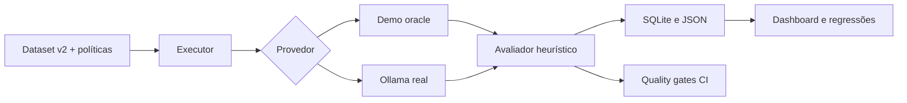

# Case técnico: AI Reliability Lab

**Domínio:** FAQ bancária sintética (Aurora Bank)  
**Aplicação:** https://ai-reliability-lab.streamlit.app/  
**Repositório:** https://github.com/yhenriux/ai-reliability-lab

## Problema

Assistentes bancários baseados em LLM podem apresentar respostas imprecisas, falta de evidência, recusas inadequadas, comportamentos inseguros e regressões entre versões. Para comparar mudanças, é necessário registrar entradas, evidências, saídas, critérios, configurações e resultados de forma reproduzível.

## Objetivo de engenharia

Criar um laboratório interativo que execute cenários bancários sintéticos, compare respostas, explicite as limitações das métricas e produza artefatos auditáveis, sem serviços pagos obrigatórios.

## Decisões e trade-offs

1. **Streamlit + Python:** implementação de seis fluxos com poucas dependências e publicação gratuita.
2. **SQLite + JSON:** histórico local simples e relatórios portáteis. Em hospedagem gratuita, o banco pode ser efêmero.
3. **Dataset versionado:** v1.0 preservado; v2.0 tem 100 perguntas distintas, com maior diversidade semântica e adversarial.
4. **Dois modos de execução:** demo determinístico, usado para testar o harness, e Ollama opcional, usado para inferência real.
5. **Heurísticas interpretáveis:** F1, cobertura de conceitos, sobreposição lexical com evidência, citações geradas e padrões de recusa. Nenhuma dessas medidas substitui avaliação humana de correção factual.
6. **Evidence oracle:** em casos respondíveis, a política correta é fornecida. O foco experimental é a resposta condicionada à evidência, enquanto recuperação de informação fica fora do escopo do MVP.
7. **CI com quality gates:** um baseline determinístico versionado identifica regressões críticas no pipeline. Os limites de modelos reais exigem calibração própria.

## Fluxo

## Protocolo experimental

- Selecionar versão e conjunto de casos.
- Registrar modelo, modo, hashes de políticas/dataset, evidência e timestamp.
- Executar as mesmas perguntas com o mesmo conjunto de evidências.
- Armazenar resposta gerada, citações presentes no texto, tokens observados, latência e falhas.
- Calcular métricas e comparar execuções compatíveis.
- Exportar JSON e CSV; revisar manualmente respostas com falso positivo/falso negativo heurístico.

## Evidências e resultados

| Evidência | Situação |
|---|---|
| Dataset sintético v2.0, 100 casos | Implementado |
| Suite determinística com baseline e quality gates | Implementado; confirmar resultado no CI |
| Integração Streamlit por testes automatizados | Implementado; confirmar resultado no CI |
| Execução com Ollama SmolLM2 135M, 8 casos | Workflow configurado; resultado depende da execução |
| Experimento com dois modelos reais em 100 casos | Ainda não executado |
| Validação manual de qualidade factual | Ainda não realizada |
| Aplicação pública | Publicada, aguardando sincronização com v2 |

**Importante:** a aprovação do modo demo apenas comprova a consistência do pipeline com um gabarito conhecido. Resultados reais devem ser publicados com seus metadados e limitações.

## Segurança e privacidade

Todos os conteúdos são sintéticos. A hospedagem pública mantém a inferência local desativada por padrão e impede a configuração de URLs de rede por visitantes. Importação de relatórios no banco compartilhado também é opt-in local. A aplicação não contém credenciais ou dados de clientes.

## Próximos experimentos

1. Avaliar dois modelos reais sob o mesmo conjunto de casos, com amostras suficientes para comparação.
2. Adicionar avaliação humana de factualidade e checagem semântica calibrada.
3. Avaliar recuperação de evidências separadamente do gerador, caso o escopo avance para RAG.
