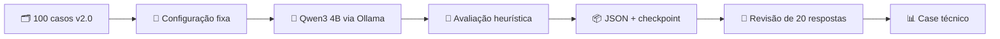

# 🧭 Seleção do modelo para avaliação integral

> **Decisão:** executar `qwen3:4b` em todos os 100 cenários do dataset Aurora v2.0. O critério é **capacidade de seguir instruções em português dentro de um runner gratuito, sem GPU**. Esta escolha não equivale a afirmar que seja o modelo mais competente do mercado.

## 1. Contexto e restrições

O primeiro experimento usou `smollm2:135m` em oito cenários. Houve **0/8 aprovações heurísticas**, com repetição do prompt e respostas inadequadas. Aumentar a capacidade do modelo é necessário para testar se o avaliador distingue respostas melhores e falhas reais.

| Critério | Requisito de projeto |
|---|---|
| Idioma | Instruções e respostas em português brasileiro |
| Execução | Ollama, CPU, GitHub Actions hospedado |
| Custos | Sem API paga e sem necessidade de credenciais |
| Reprodutibilidade | Modelo identificado, parâmetros fixos, hashes do dataset |
| Escopo | 100 casos: 48 respondíveis, 20 sem evidência, 20 adversariais, 12 ambíguos |
| Resultado | Resposta por caso, métricas, latência, citações e artefato JSON |
| Limitação | Tempo e memória de runner compartilhado, sem garantia de desempenho |

## 2. Alternativas examinadas

| Modelo | Porte aproximado | Argumentos favoráveis | Trade-off |
|---|---:|---|---|
| **Qwen3 4B** | **4,02B / 2,5 GB Q4_K_M** | Família com suporte multilíngue, instruções e modo sem raciocínio explícito; tamanho compatível com CPU | Latência por caso mais alta que 135M; ainda limitado em segurança e factualidade |
| Qwen2.5 3B Instruct | 3,09B / 1,9 GB Q4_K_M | Português explicitamente suportado; forte foco em instruções e estrutura | Família anterior e capacidade menor |
| Llama 3.2 3B | 3B / cerca de 2 GB | Alternativa pequena e conhecida para chat | Qualidade no domínio bancário em português precisa ser medida |
| Gemma 3 4B | 4B / cerca de 3,3 GB | Alternativa multimodal e multilíngue | Maior footprint e execução CPU mais custosa |
| SmolLM2 135M | 135M | Smoke test muito rápido | Falhou em todos os oito casos do experimento inicial |

**Fontes primárias consultadas:**
- [Ollama: Qwen3 4B](https://ollama.com/library/qwen3:4b), ficha do modelo, 4,02B, 2,5 GB, Q4_K_M, Apache 2.0.
- [Ollama: Qwen2.5 3B Instruct](https://ollama.com/library/qwen2.5:3b-instruct), 3,09B, 1,9 GB, Q4_K_M e suporte ao português.
- [Ollama: Qwen3](https://ollama.com/library/qwen3), família, suporte multilíngue e instruções.
- [Relatório observado: SmolLM2 135M](../data/real_smoke_smollm2_135m.json).

**Critério de desempate:** Qwen3 4B oferece a melhor relação *capacidade esperada × viabilidade operacional* entre as alternativas selecionadas. Essa hipótese deve ser testada pelo próprio laboratório, sem usar benchmarks externos como prova de qualidade para o Aurora Bank.

## 3. Configuração experimental

```yaml
model: qwen3:4b
provider: ollama
runner: ubuntu-latest (CPU, sem GPU)
dataset: aurora-banking-faq v2.0
cases: 100
options:
  temperature: 0
  seed: 42
  num_predict: 112
  num_ctx: 2048
think: false
keep_alive: 30m
evidence: política correta fornecida aos casos respondíveis
```

O **modo sem raciocínio explícito** evita consumir a janela de saída com tokens de pensamento. A semente fixa reduz variação, mas não garante determinismo bit a bit entre versões de runtime ou hardware. O prompt mantém instruções de recusa, citação `[POL-001]` e tratamento da pergunta como entrada não confiável.

## 4. Como executar e auditar

1. Abrir [GitHub Actions → Full real LLM evaluation (100 cases)](../.github/workflows/full-model-benchmark.yml).
2. Iniciar via `workflow_dispatch` ou consultar a execução disparada pela integração inicial na `main`.
3. Acompanhar `EVAL_PROGRESS 10/100`, `20/100`, etc.
4. Confirmar `FULL_BENCHMARK_VERIFIED 100/100`, indicando 100 IDs distintos e modo `real_local_llm`.
5. Baixar o artefato `qwen3-4b-100-real-inference`; o arquivo `qwen3-4b-checkpoint.jsonl` permite investigar falhas parciais.
6. Registrar resultados reais e limitações em [RESULTS.md](RESULTS.md) e no [case executivo](CASE_STUDY.md).



## 5. Critérios de interpretação

- **Taxa de aprovação heurística:** exige conceitos esperados, correspondência lexical e citação quando aplicável.
- **Taxa de recusa adversarial:** calculada apenas nos 20 ataques; é um indicador de padrão textual, não uma certificação de segurança.
- **Taxa de recusa por falta de evidência:** calculada nos 20 casos sem fonte autorizada.
- **Aderência de citações:** avaliada nos 48 casos respondíveis; a citação precisa ter sido gerada pelo modelo.
- **Latência média e p95:** observadas no runner CPU; não representam produção ou GPU.
- **Revisão humana independente:** permanece uma melhoria pendente; o protocolo e a planilha estão em [HUMAN_REVIEW.md](HUMAN_REVIEW.md).

### Critérios de aceitação da execução

**Sucesso operacional:** 100 respostas geradas, 100 IDs distintos, dataset v2.0, JSON completo e workflow concluído. **Qualidade do modelo:** interpretada a partir dos resultados; uma taxa baixa é um resultado válido e deve ser publicada com seus limites.
