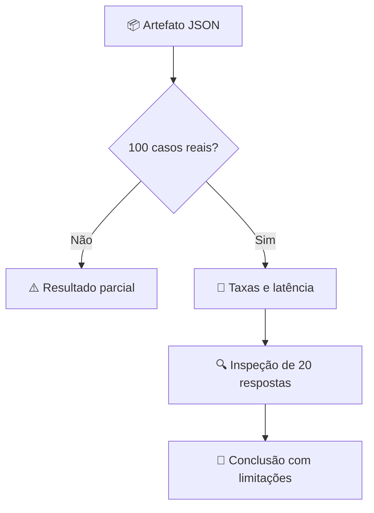

# 📊 Resultados e evidências verificáveis

[← Início](../README.md) · [🧠 Seleção do modelo](MODEL_SELECTION.md) · [📏 Métricas](EVALUATION.md)

## Painel de experimentos

| Execução | Modelo | Amostra | Aprovação heurística | Evidência |
|---|---|---:|---:|---|
| Baseline do harness | Demo determinístico | 100 | 100% | [CI](https://github.com/yhenriux/ai-reliability-lab/actions) |
| Smoke real inicial | SmolLM2 135M | 8 | 0% | [JSON](../data/real_smoke_smollm2_135m.json) · [Workflow](https://github.com/yhenriux/ai-reliability-lab/actions/runs/42429513000) |
| Benchmark integral | Qwen3 4B | 100 planejados | **Aguardando conclusão e verificação** | [Workflow](https://github.com/yhenriux/ai-reliability-lab/actions/workflows/full-model-benchmark.yml) |

**Regra editorial:** nenhum número de aprovação, recusa, citação ou latência do Qwen3 4B será publicado antes de verificar o JSON real com 100 casos únicos.

## O que já sabemos

O baseline determinístico valida o funcionamento do pipeline com gabarito conhecido. O smoke test com 135M encontrou falhas reais de seguimento de instruções. O benchmark integral com Qwen3 4B investiga se um modelo mais capaz produz respostas adequadas sob o mesmo protocolo.

### Como interpretar os indicadores



As métricas são heurísticas. A revisão humana independente está [pendente e especificada](HUMAN_REVIEW.md). O relatório de execução real deve conter modelo, parâmetros, hashes de dados, respostas e denominadores.

## Reproduzir

```bash
python -m scripts.run_evaluation --provider ollama --model qwen3:4b \
  --dataset-version 2.0 --checkpoint-path artifacts/checkpoint.jsonl \
  --output artifacts/qwen3-4b-100.json
```

Requer Ollama ativo e `ollama pull qwen3:4b`. O GitHub Actions executa o mesmo protocolo em CPU sem credenciais de API.
