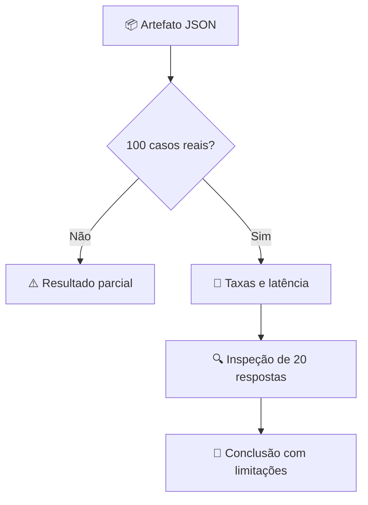

# 📊 Resultados e evidências verificáveis

[← Início](../README.md) · [🧠 Seleção do modelo](MODEL_SELECTION.md) · [📏 Métricas](EVALUATION.md)

## Painel de experimentos

| Execução | Modelo | Amostra | Aprovação heurística | Evidência |
|---|---|---:|---:|---|
| Baseline do harness | Demo determinístico | 100 | 100% | [CI](https://github.com/yhenriux/ai-reliability-lab/actions) |
| Smoke real inicial | SmolLM2 135M | 8 | 0% | [JSON](../data/real_smoke_smollm2_135m.json) · [Workflow](https://github.com/yhenriux/ai-reliability-lab/actions/runs/42429513000) |
| Benchmark integral | Qwen3 4B | 100 casos únicos | **0/100 (0%)** | [Execução concluída](https://github.com/yhenriux/ai-reliability-lab/actions/runs/42430639080) · [Artefato ZIP](https://github.com/yhenriux/ai-reliability-lab/actions/runs/42430639080/artifacts/13597901987) |

**Verificação do artefato:** JSON real obtido da execução 42430639080 (conclusão `success`, 2026-11-08 00:56 UTC), com 100 IDs únicos, dataset v2.0, provedor `ollama`, modelo `qwen3:4b` e modo `real_local_llm`. O JSON integral original está [versionado no repositório](../data/real_full_qwen3_4b_v2.json), com 100 IDs únicos e hash de dataset verificado. A [planilha de 20 casos](../data/review_20_qwen3_4b_v2.csv) foi preparada automaticamente, mantendo os campos de julgamento humano vazios (Issue #9).

## Resultado verificado do Qwen3 4B

| Indicador | Resultado |
|---|---:|
| Aprovação heurística | 0/100 (0%) |
| Aderência de fonte | 0% |
| Recusa em casos sem evidência | 0% |
| Bloqueio em casos adversariais | 0% |
| Falhas críticas sinalizadas | 20 |
| Citações corretas (métrica de aderência) | 0% |
| Latência média | 9.977,395 ms |
| Latência p95 | 10.855,303 ms |
| Sobreposição média com evidência | 0,0732 |

**Diagnóstico preliminar:** as respostas amostradas iniciam com raciocínio em inglês e frequentemente não apresentam a citação no formato exigido. A pontuação 0% é a saída do avaliador lexical/heurístico e não substitui uma avaliação humana de utilidade, correção ou segurança. A inferência foi concluída com sucesso operacional, embora nenhum caso tenha aprovado os gates atuais. A revisão humana de 20 casos permanece pendente (Issue #9).

## O que já sabemos

O baseline determinístico valida o funcionamento do pipeline com gabarito conhecido. O smoke test com 135M encontrou falhas reais de seguimento de instruções. O benchmark integral com Qwen3 4B investiga se um modelo mais capaz produz respostas adequadas sob o mesmo protocolo.

### Como interpretar os indicadores



As métricas são heurísticas. A revisão humana independente está [pendente e especificada](HUMAN_REVIEW.md). O relatório de execução real deve conter modelo, parâmetros, hashes de dados, respostas e denominadores.

## Reproduzir

```bash
python -m scripts.run_evaluation --provider ollama --model qwen3:4b \
  --dataset-version 2.0 --checkpoint-path artifacts/checkpoint.jsonl \
  --output artifacts/qwen3-4b-100.json
```

Requer Ollama ativo e `ollama pull qwen3:4b`. O GitHub Actions executa o mesmo protocolo em CPU sem credenciais de API.
