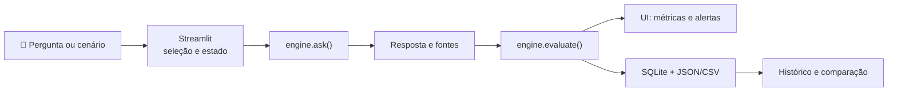

# 🖥️ Verificação de experiência, front-end e back-end

**Escopo:** revisar coerência dos seis módulos Streamlit com os serviços Python, dados, persistência, segurança e fluxos de exportação.

> **Estado da evidência:** os testes de integração executam o aplicativo real com `streamlit.testing.v1.AppTest`. A aplicação pública já foi aberta e utilizada pelo responsável pelo projeto. Uma consulta de leitura ao navegador conectado identificou a aba da aplicação, mas disponibilizou apenas o controle “Manage app”; portanto, esta revisão **não afirma ter clicado remotamente em todos os controles do site publicado**.

## 1. Inventário de jornadas

| Jornada | Entrada | Backend esperado | Evidência de teste | Situação |
|---|---|---|---|---|
| Dashboard | Seleção de dataset | `load_data`, `list_runs`, métricas | AppTest: renderização sem exceção | Automatizado |
| Playground | Pergunta livre ou caso rotulado | `ask` + `evaluate` | AppTest + motor; pergunta livre sem score | Automatizado |
| Evaluation Studio | Categorias e execução | `execute_suite` e SQLite | AppTest executa 100 casos demo | Automatizado |
| Regression Testing | Duas execuções compatíveis | `compare_runs` e `evaluate_gates` | Teste de motor e teste de jornada de comparação | Automatizado |
| Safety Lab | Caso único ou suíte | `execute_suite` com subconjunto | AppTest executa caso único | Automatizado |
| Reports & History | Histórico e download | `list_runs`, serialização JSON/CSV | Teste de renderização e integridade dos relatórios | Automatizado |
| Deploy público | URL Streamlit Cloud | `app.py` e `requirements.txt` | Publicação observada pelo usuário | Confirmado pelo responsável |

**Limite:** o AppTest verifica componentes e transições em ambiente de teste. A compatibilidade real com diferentes navegadores, tamanhos de tela e downloads locais ainda pode exigir inspeção manual.

## 2. Contratos entre interface e engine

### Coerência confirmada no código

- O `dataset_version` é passado à suíte e registrado no relatório.
- O modo demo é identificado como oráculo e não deve ser usado como resultado de modelo.
- O modo Ollama recebe um endpoint definido pelo operador; o visitante da hospedagem pública não configura URLs arbitrárias.
- Perguntas livres não recebem score com referência inexistente.
- A interface permite baixar JSON e CSV, inclusive resultados reais versionados.
- A comparação de regressões exige versão e hash de dataset compatíveis; diferenças na cobertura devem ser exibidas ao avaliador.
- A importação de JSON fica desativada na hospedagem pública por padrão.

## 3. Pontos de atenção de UX e engenharia

| Severidade | Achado | Impacto | Encaminhamento |
|---|---|---|---|
| Média | Histórico SQLite na nuvem é efêmero | Execuções interativas podem desaparecer após reinício | JSON/CSV e relatórios reais versionados |
| Média | O demo pode mostrar 100% e o modelo real 0% | Leitura equivocada por visitantes | Rotular modo, denominador e amostra em todas as visões |
| Média | Comparação com quantidades diferentes de casos | Deltas calculados apenas sobre interseção | Avisar sobre cobertura e recomendar conjuntos iguais |
| Baixa | Streamlit controla estrutura e responsividade | Menor liberdade visual que front-end customizado | Testar componentes nativos e evitar densidade excessiva |
| Alta para produção | Segurança heurística incompleta | Falsas recusas e respostas inseguras podem passar | Revisão humana e segurança em camadas antes de uso real |
| Baixa | Exportação não persiste automaticamente na nuvem | Necessidade de download explícito | Explicar retenção no próprio módulo |

## 4. Checklist de aceite

- [x] Seis módulos instanciados em teste automatizado.
- [x] Execução de 100 casos demo pela interface de teste.
- [x] Execução de cenário individual de segurança pela interface de teste.
- [x] Quality gates e regressões cobertos por testes de motor.
- [x] Dados sintéticos e interface pública sem necessidade de API key.
- [x] Aplicação pública aberta e testada pelo responsável.
- [ ] Auditoria humana independente de acessibilidade (WCAG 2.2 AA).
- [ ] Matriz de navegadores/dispositivos com evidência visual.
- [ ] Teste manual de download em navegador com arquivo efetivamente salvo.
- [ ] Revisão humana de 20 respostas reais.

**Critério de conclusão da auditoria técnica:** CI verde, fluxos automatizados sem exceções, links válidos e limites de interface documentados. Os itens pendentes acima permanecem no [roadmap](ROADMAP.md) e não impedem a publicação como laboratório experimental.
